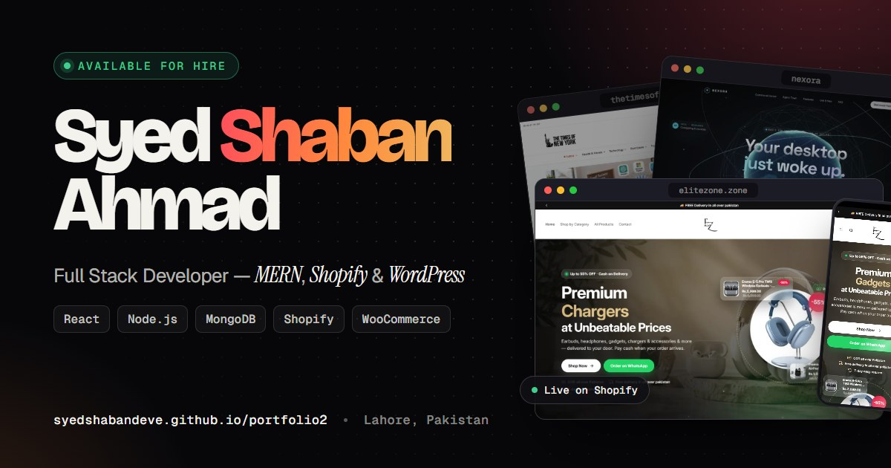

<div align="center">

# Syed Shaban Ahmad — Developer Portfolio · v2

**Full Stack Developer · MERN, Shopify &amp; WordPress · Lahore, Pakistan**

[](https://syedshabandeve.github.io/portfolio2/)
[](https://react.dev)
[](https://vite.dev)
[](package.json)
[](LICENSE)

<a href="https://syedshabandeve.github.io/portfolio2/">
  
</a>

**→ [View it live](https://syedshabandeve.github.io/portfolio2/)**

</div>

---

## About

> This is the second design of my portfolio. The main one lives at
> [syedshabandeve.github.io/portfolio](https://syedshabandeve.github.io/portfolio/).

A single-page portfolio built from scratch — no template, no page builder, no UI kit, and no
component library. It presents my experience, the work I have shipped, and a direct route to
contact me.

The only runtime dependencies are `react` and `react-dom`. Everything else — the design system,
the motion, the case-study panels, the command palette, the icon set, the theme switching — is
written for this project.

## Features

| | |
| --- | --- |
| **Interactive hero** | A canvas dot field that swells and leans away from the cursor (and drifts on its own on touch screens), letter-by-letter name reveal, and real captures of shipped work layered at different depths that part as the pointer moves. |
| **Case studies** | Every project opens a native `<dialog>` with the full-page capture to scroll through, phone views, what was built, role and stack. Each one has its own URL (`#work/<id>`), the browser's Back button closes it, and arrow keys move between projects. |
| **Live captures** | Project cards show the real site; hovering a card scrolls through the whole page capture, loaded only on first hover. |
| **Command palette** | `Ctrl K` / `⌘K` (or `/`) jumps to any section, opens any case study, copies the email, downloads the CV or switches theme — a keyboard-driven listbox built on `aria-activedescendant`. |
| **Light and dark themes** | A toggle that respects `prefers-color-scheme`, persists the visitor's choice, and applies it in an inline script before first paint so the page never flashes the wrong palette. With View Transitions, the new palette wipes in as a circle from the toggle. |
| **Design-token system** | One layer of CSS custom properties drives both palettes, a fluid `clamp()` type scale, spacing, radii and easing. Changing a token changes the whole site. |
| **Section-aware navigation** | The nav highlight tracks whichever section is nearest the top of the viewport, and anchors to the last section at the end of the page. |
| **Scroll progress + back to top** | A single rAF-throttled scroll listener feeds the progress bar, the sticky nav state and the back-to-top button. |
| **Filterable project grid** | Work filters by discipline — Shopify, full stack, WordPress, open source — with featured builds given a wide showcase row, and cards gliding to their new places when the filter changes. |
| **Pointer details** | One delegated listener drives a spotlight on every card, call-to-action buttons lean toward the cursor, and the experience timeline fills as you read down it. All of it is off for touch input and reduced motion. |
| **Reveal animations** | A reusable `Reveal` component fades content in once, then disconnects its observer so nothing keeps running off-screen. |
| **Validated contact form** | Inline, screen-reader-linked error messages; a valid submission opens the visitor's own mail client with the whole message composed. Nothing routes through a third party. |
| **Downloadable CV** | A typeset, text-selectable PDF plus the original DOCX for applicant tracking systems. |
| **Accessible** | Skip link, semantic landmarks, `aria-invalid` / `aria-describedby` wiring, `aria-pressed` filters, labelled icon links, visible focus rings, and a `prefers-reduced-motion` fallback that disables animation. |
| **SEO and social ready** | Descriptive metadata, canonical URL, Open Graph and Twitter cards, JSON-LD `Person` structured data, `robots.txt`, `sitemap.xml` and a web manifest. |

## Tech Stack

| Layer | Choice |
| --- | --- |
| Framework | React 19 |
| Build tool | Vite 8 |
| Styling | Hand-written CSS with custom properties — no framework |
| Icons | Inline SVG sprite in `components/ui/Icon.jsx`, plus brand marks from [Simple Icons](https://simpleicons.org) (CC0) inlined in `data/logos.js` — no icon package, no icon requests |
| Type | Bricolage Grotesque, Geist, Geist Mono and Instrument Serif from Google Fonts |
| Linting | ESLint 10 (`react-hooks`, `react-refresh`) |
| Hosting | GitHub Pages via `gh-pages` |

## Running Locally

```bash
git clone https://github.com/SyedShabanDeve/portfolio2.git
cd portfolio2
npm install
npm run dev
```

Vite prints a local URL, by default `http://localhost:5173/portfolio2/`.

### Scripts

| Command | What it does |
| --- | --- |
| `npm run dev` | Start the dev server with hot module replacement |
| `npm run build` | Produce the optimised production bundle in `dist/` |
| `npm run preview` | Serve the built bundle locally |
| `npm run lint` | Run ESLint across the project |
| `npm run deploy` | Build, then publish `dist/` to GitHub Pages |

## Project Structure

```
portfolio2/
├── public/
│   ├── og-image.jpg              # 1200x630 social preview card
│   ├── work/                     # Project captures (WebP), see "Adding a project"
│   ├── logo.svg  favicon.svg     # Brand mark
│   ├── Syed-Shaban-Ahmad-CV.pdf  # Downloadable CV
│   ├── robots.txt  sitemap.xml  site.webmanifest
├── src/
│   ├── data/
│   │   ├── site.js               # Every piece of page content, in one file
│   │   └── logos.js              # Brand marks for the stack (generated from Simple Icons)
│   ├── lib/                      # Image paths, motion preferences, toast + clipboard
│   ├── styles/
│   │   ├── tokens.css            # Palettes, type scale, spacing, easing
│   │   ├── base.css              # Reset, layout primitives, animations
│   │   ├── components.css        # Buttons, chips, cards, browser and phone frames
│   │   ├── layout.css            # Nav, menu, footer, dialogs, view transitions
│   │   └── sections.css          # Hero to contact, plus the responsive rules
│   ├── hooks/
│   │   ├── useTheme.js           # Light/dark with system + localStorage + circle reveal
│   │   ├── useProjectHash.js     # Open case study ⇄ #work/<id> and browser history
│   │   ├── useScrollState.js     # Progress, sticky nav, past-the-fold
│   │   ├── useActiveSection.js   # Nav highlight tracking
│   │   ├── useSpotlight.js       # One pointer listener for every card glow
│   │   ├── useNow.js             # Shared ticking clock for the local time
│   │   ├── useLockScroll.js      # Page scroll lock under overlays
│   │   ├── useInView.js          # One-shot IntersectionObserver
│   │   └── useTypewriter.js      # Hero role cycling
│   ├── components/
│   │   ├── ui/                   # Icon, Reveal, SectionHead, SplitWords, BrowserFrame,
│   │   │                         # PhoneFrame, Cover, CountUp, Magnetic, LocalTime, Toast
│   │   └── Navbar · Hero · HeroCanvas · ProjectStack · Typer · Marquee
│   │       Projects · ProjectDialog · About · Skills · Experience · Services
│   │       Contact · ContactForm · Footer · BackToTop · CommandPalette
│   ├── index.css                 # Imports the five style layers
│   ├── App.jsx
│   └── main.jsx
├── index.html                    # Metadata, theme boot script, JSON-LD
└── vite.config.js                # `base` is /portfolio2/ for GitHub Pages
```

Content lives in `src/data/site.js` and nowhere else — components read from it, so updating a
job, a project or a skill never means touching markup.

## Adding a project

1. Add an entry to `PROJECTS` in `src/data/site.js` — copy an existing one. `details` is what the
   case-study panel shows; `featured: true` gives it a wide showcase row.
2. Put its captures in `public/work/`, named after the project's `image` key:

   | File | What it is |
   | --- | --- |
   | `<image>.webp` | First screen at 1280×800 |
   | `<image>-full.webp` | The whole page at 1280 wide (cropped to ~3800 tall) |
   | `<image>-m.webp` | Phone view at 390×844 |

   Leave `image` out and the card draws a cover from the project's name instead.

## Deployment

```bash
npm run deploy
```

`vite.config.js` sets `base: '/portfolio2/'` so hashed assets resolve under the repository
subpath. If you fork this and host it elsewhere, change `base` to match, and update the absolute
URLs in `index.html` (canonical, `og:url`, `og:image`) plus `sitemap.xml`, `robots.txt` and
`site.webmanifest`.

## Contact

- **Email** — [syedshaban785@gmail.com](mailto:syedshaban785@gmail.com)
- **LinkedIn** — [syedshaban785](https://www.linkedin.com/in/syedshaban785)
- **GitHub** — [SyedShabanDeve](https://github.com/SyedShabanDeve)
- **Location** — Lahore, Pakistan · open to remote work

## License

Released under the [MIT License](LICENSE). The code is free to reuse; please replace the personal
content, images, CV and contact details with your own.
